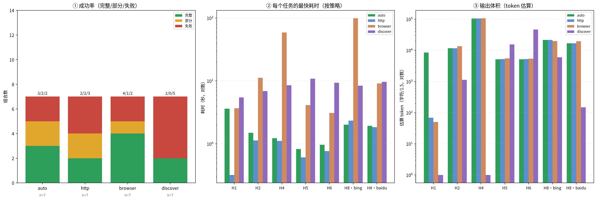
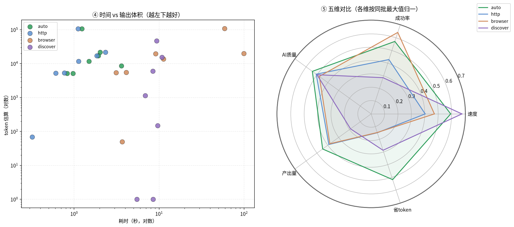

# fetch-hard 全量测评（2026-11-09）

| 项 | 值 |
|---|---|
| 被测 | sf（Go 版），浏览器一律有头 |
| 策略 | 4 种：auto / http / browser / discover |
| 组合 | 34 组（含能力与参数验证） |
| 结果 | 16 完整 / 5 部分 / 13 失败 |

## 图表怎么读

| 颜色/符号 | 含义 |
|---|---|
| 🟩 绿 / ✓ | 完整完成 |
| 🟨 黄 / ◐ | 部分完成 |
| 🟥 红 / ✗ | 失败 |
| ⬜ 灰 / – | 该策略不适用于此任务（不是没测） |

**策略只有四种**：auto（先 cffi 再升浏览器）、http（纯 cffi）、browser（全程有头浏览器）、
discover（先分析数据在哪 → 接口/http/browser，可多轮）。
`-s` 登录态与 `-L brief` 是**能力/参数**，不参与策略排名。

## 多维度对比

| 策略 | 组合数 | 完整 | 部分 | 失败 | 耗时中位数 | token 中位数 | AI 均分 |
|---|---|---|---|---|---|---|---|
| **auto** | 7 | 3 | 2 | 2 | 1.5s | 11759 | 2.71 |
| **http** | 7 | 2 | 2 | 3 | 1.11s | 11759 | 2.54 |
| **browser** | 7 | 4 | 1 | 2 | 9.13s | 13659 | 2.39 |
| **discover** | 7 | 2 | 0 | 5 | 8.52s | 1137 | 2.5 |

> token 是估算（输出字符 ÷ 1.5），只用于横向比较相对量级，不是计费数字。
> 雷达图各维按同批最大值归一，越小越差。

## 每个任务、每种策略：评估 agent 的评价

（分数为 完整性/干净度/结构/可用性 四项均分，1–5）

### H1 36kr 反爬+多页

| 策略 | 完成 | 耗时 | token | AI 分 | 评估意见 |
|---|---|---|---|---|---|
| auto | ✅ | 3.61s | 8574 | 2.25 | 36 条文章块齐全；但 334 个链接全是 @ 占位，对照表只给前 50 条，仅 6 个 /p/ URL 可解析；前 160 行是导航墙。 |
| http | ❌ | 0.32s | 69 | 1.0 | 火山引擎安全检测页，0 条文章 0 链接，纯风控拦截。 |
| browser | ✅ | 3.67s | 50 | 1.0 | 整页只有 Internal Server Error（500 空页），0 条目。 |
| discover | ❌ | 5.47s | 1 | 1.0 | 文件仅 1 字节空行，连候选接口表都没有。 |

### H2 跨站对照

| 策略 | 完成 | 耗时 | token | AI 分 | 评估意见 |
|---|---|---|---|---|---|
| auto | ✅ | 1.5s | 11759 | 3.5 | 三站齐全、分级清楚；但每站链接对照截断前 50 条（gov.cn 281 个引用只 50 个可解析），有导航和空链接。 |
| http | ✅ | 1.13s | 11759 | 3.5 | 与 auto 逐行一致，同样三站齐全、同样只映射前 50 条链接。 |
| browser | ✅ | 11.26s | 13659 | 3.25 | 三站齐全且澎湃多出顶部要闻；但 6 条新闻重复两遍（某条出现 4 次），149 引用只映射 50 个。 |
| discover | ❌ | 6.88s | 1137 | 2.25 | 只有候选接口表（澎湃 19 个、阮一峰 2 个挑战端点、gov.cn 缺失），无文章内容，只能当线索。 |

### H4 长文档

| 策略 | 完成 | 耗时 | token | AI 分 | 评估意见 |
|---|---|---|---|---|---|
| auto | ✅ | 1.23s | 106373 | 3.5 | 正文齐全（15 个 h2、引用到 206）；但 1661 行里前后约 660 行是语言列表/导航框，28 处 [edit]、12 个空图占位。 |
| http | ✅ | 1.11s | 106373 | 3.5 | 与 auto 逐字等价（161930 字节、1661 行），噪声同样过半。 |
| browser | ✅ | 58.97s | 108113 | 3.5 | 正文同级完整，但比 auto/http 多 44 行浏览器导航，1705 行，噪声更多。 |
| discover | ❌ | 8.52s | 1 | – | （无样本） |

### H5 接口列表

| 策略 | 完成 | 耗时 | token | AI 分 | 评估意见 |
|---|---|---|---|---|---|
| auto | ◐ | 0.83s | 5158 | 2.25 | 10 篇文章标题+作者齐全；73 个空链接、26 处图片占位，对照表截断使 97/147 引用失效，仅 5/10 能解析 URL。 |
| http | ◐ | 0.61s | 5263 | 2.25 | 10 篇、78 个空链接、27 图片占位，106/156 引用失效，5/10 有 URL。 |
| browser | ✅ | 4.12s | 5529 | 2.25 | 10 篇、78 空链接、29 图片占位，108/158 引用无对照，仅 4/10 有 URL。 |
| discover | ✅ | 10.84s | 15526 | 3.5 | 单行 JSON 10 条，字段齐全、0 广告 0 空链接；但无 url 字段、元数据噪声占八成，需拼 sspai.com/post/{id}。 |

### H6 多轮接口

| 策略 | 完成 | 耗时 | token | AI 分 | 评估意见 |
|---|---|---|---|---|---|
| auto | ❌ | 0.97s | 5154 | 2.25 | 仍是一页 10 篇（与 H5_auto 相似度 0.90），多轮未体现。 |
| http | ❌ | 0.77s | 5283 | 2.25 | 与 H5 单页基本一致，分页目标未达成。 |
| browser | ❌ | 3.11s | 5414 | 2.25 | 仍为单页首页（与 H5_browser 相似度 0.66），3 页未体现。 |
| discover | ✅ | 9.34s | 46676 | 3.5 | 3 页共 30 篇、0 重复、时间跨页连续；但无 url 字段、JSON 连排无分页标记。 |

### H8 bing 搜索

| 策略 | 完成 | 耗时 | token | AI 分 | 评估意见 |
|---|---|---|---|---|---|
| auto | ◐ | 2.02s | 21674 | 3.0 | 两页 20 条结果标题/摘要齐全；真实链接全是 ck/a 需解 base64，AI 摘要占 page1 一半。 |
| http | ◐ | 2.34s | 21624 | 3.0 | 同页同结果，20 条，70 条链接仍需解码。 |
| browser | ◐ | 99.45s | 19863 | 2.75 | 结果数与 auto 一致，但每条前插图标占位，93 个 @ 中 43 个无映射，更杂乱。 |
| discover | ❌ | 8.44s | 6018 | 2.25 | 111 条候选中 100 条是静态脚本，唯一 JSON 是 49B 验证端点，无搜索结果接口。 |

### H8 百度搜索

| 策略 | 完成 | 耗时 | token | AI 分 | 评估意见 |
|---|---|---|---|---|---|
| auto | ❌ | 1.93s | 16984 | 2.25 | 18 条标题摘要，但链接全是 baidu link?url 跳转，无真实 URL；前 38% 是导航热搜。 |
| http | ❌ | 1.85s | 16972 | 2.25 | 同 baidu auto，18 条、0 真实 URL、9 条无链接。 |
| browser | ❌ | 9.13s | 19669 | 1.75 | 导航+热搜包围，前 43% 噪声，16/18 条无 URL。 |
| discover | ❌ | 9.64s | 148 | 2.5 | 仅 2 条候选（联想词/搜索端点），无结果接口。 |

## 结论

1. **auto 与 http 是默认解**：静态页/长文档/跨站列表上结果与 browser 一致，但快 7–50 倍。
2. **browser 只在必须渲染时用**：H1(36kr) 是唯一 non-http 能过的场景；H4 上同内容慢 50 倍。
3. **discover 是决策层**：H5/H6 走接口明显更好（AI 3.5 vs 2.2）；H1/H2/H8 分析完应直接 http/browser，
   强行找接口只会白花 6–10 秒并拿 0 条。
4. **token 维度**：browser 输出体积普遍大 1 个数量级（导航/图片占位），brief 虽省 token 但毁结构。
5. **能力**：三后端登录态均分 4.8；brief 在长文档上只有 1.5。
