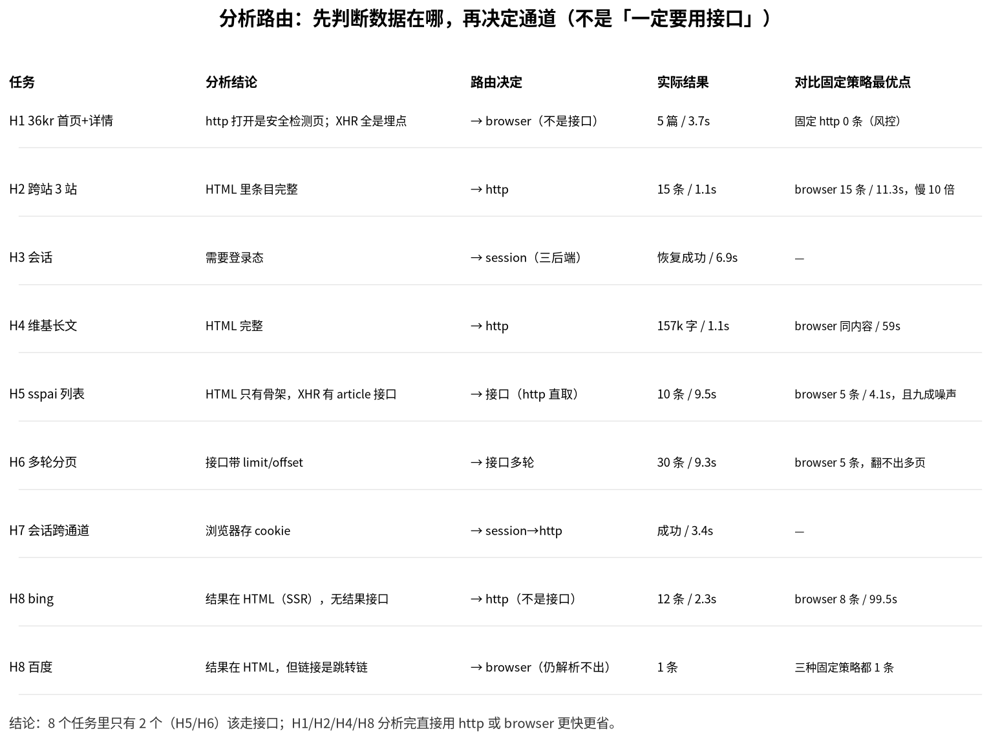

# fetch-hard 全量测评（2026-11-09）

| 项 | 值 |
|---|---|
| 被测 | sf（Go 版），**浏览器一律有头** |
| 任务 | H1–H8（搜索引擎 H8 也按 auto/http/browser/discovery3 全跑） |
| 组合 | 32 组 |
| 结果 | 16 完整 / 5 部分 / 11 失败 |


## 重新理解 discovery：它是「分析路由」，不是固定流水线

之前把 discovery 当成"发现接口→用接口"的固定三步，所以 H1/H2/H8 强行找接口只能拿 0 条。
正确的用法是**先分析、再路由**：

```
分析：HTML 里有没有内容？XHR 里有没有列表？必须 JS 吗？要登录吗？
  ├─ HTML 已有     → http
  ├─ XHR 有列表    → 接口
  ├─ 必须渲染      → browser
  └─ 要登录        → 会话 + 上面任意一条
```



**8 个任务里只有 2 个（H5/H6）该走接口**；H1/H2/H4/H8 分析完直接用 http 或 browser
更快更省。下文矩阵里的「强制接口」列，就是**错误实现**（不管分析结论一律找接口）的成绩，
它恰好证明了：分析这一步不能省。

## 图表怎么读

颜色在所有子图里一致：

| 颜色/符号 | 含义 |
|---|---|
| 🟩 绿 / ✓ | 完整完成 |
| 🟨 黄 / ◐ | 部分完成 |
| 🟥 红 / ✗ | 失败（风控 / 解析不出 / 0 条） |
| ⬜ 灰 / – | **未测**（该任务没跑这个策略） |

**策略只有四种**：`auto`（先 cffi 再升浏览器）、`http`（纯 cffi）、`browser`（全程有头浏览器）、
`discover`（先分析数据在哪 → 接口/http/browser，可多轮）。

**不是策略**：`session`（`-s` 登录态）是能力，`brief`（`-L brief`）是输出档位。
它们叠加在策略上，不单独计分——所以下文的 H3/H7（会话）与 H4·brief 是**能力验证**，不参与策略排名。

## 结果明细

| 任务 | 策略 | 完成 | 产出 | 耗时 |
|---|---|---|---|---|
| H1 | auto | ✅ | 5 | 3.61s |
| H1 | browser | ✅ | 5 | 3.67s |
| H1 | discovery3 | ❌ | 0 | 5.47s |
| H1 | http | ❌ | 0 | 0.32s |
| H2 | auto | ✅ | 15 | 1.5s |
| H2 | browser | ✅ | 15 | 11.26s |
| H2 | discovery3 | ❌ | 0 | 6.88s |
| H2 | http | ✅ | 15 | 1.13s |
| H3 | session-chromedp | ✅ | 1 | 16.69s |
| H3 | session-gomoufox | ✅ | 1 | 41.84s |
| H3 | session-nodriver | ✅ | 1 | 6.86s |
| H4 | auto | ✅ | 1 | 1.23s |
| H4 | brief | ❌ | 1 | 2.83s |
| H4 | browser | ✅ | 1 | 58.97s |
| H4 | http | ✅ | 1 | 1.11s |
| H5 | auto | ◐ | 6 | 0.83s |
| H5 | browser | ✅ | 5 | 4.12s |
| H5 | discovery3 | ✅ | 10 | 10.84s |
| H5 | http | ◐ | 6 | 0.61s |
| H6 | browser | ❌ | 5 | 3.11s |
| H6 | discovery3 | ✅ | 30 | 9.34s |
| H6 | http | ❌ | 6 | 0.77s |
| H7 | session→browser | ✅ | 1 | 4.14s |
| H7 | session→http | ✅ | 1 | 3.4s |
| H8 | baidu·auto | ❌ | 1 | 1.93s |
| H8 | baidu·browser | ❌ | 1 | 9.13s |
| H8 | baidu·discovery3 | ❌ | 0 | 9.64s |
| H8 | baidu·http | ❌ | 1 | 1.85s |
| H8 | bing·auto | ◐ | 13 | 2.02s |
| H8 | bing·browser | ◐ | 8 | 99.45s |
| H8 | bing·discovery3 | ❌ | 0 | 8.44s |
| H8 | bing·http | ◐ | 12 | 2.34s |

## 分任务结论

### H1 反爬（36kr）

auto / browser / discovery3 三条：auto 与 browser 都 5 篇详情 5/5；**http 0 条**（纯 cffi 完全拿不到）；
**discovery3 0 条**——36kr 的 XHR 都是埋点/推荐位，没有可直取的列表接口。

### H2 跨站（gov / 澎湃 / 阮一峰）

auto / http / browser 都 15 条；auto 1.5s、http 1.1s、browser 11.3s。
**discovery3 0 条**：三个站都是服务端渲染，没有 JSON 列表接口可捡。

### H3 会话

session × 三后端全部成功：nodriver 6.9s、chromedp 16.7s、gomoufox 41.8s。

### H4 长文档

auto / http / browser 结果完全一致（157k 字、33 标题）；耗时 1.2s / 1.1s / 59.0s。
`-L brief` 失败：787 字、2 个标题——截断毁结构。

### H5 接口路线（sspai 列表）

discovery3 **10 条 / 10.8s**（发现 9s + 取数 0.5s）；browser 5 条 / 4.1s；http 6 条 / 0.6s；auto 6 条。
接口路线条目最多、最干净，代价是一次性发现。

### H6 多轮接口

discovery3 **30 条 / 9.3s**（3 页，每页 0.5s）；browser 5 条；http 6 条——不发现接口就翻不出多页。

### H7 会话跨通道

session→http 3.4s、session→browser 4.1s，都能读到 cookie。

### H8 搜索引擎（不用 sv）

| 策略 | bing | 百度 |
|---|---|---|
| auto | ◐ 13 条 / 2.0s | ❌ 1 条 |
| http | ◐ 12 条 / 2.3s | ❌ 1 条 |
| browser | ◐ 8 条 / 99.5s | ❌ 1 条 |
| discovery3 | ❌ 0 条 / 8.4s | ❌ 0 条 / 9.6s |

- bing：跳转链能解 base64，两种策略都能拿到 12–13 条，但**cffi 翻页无效**（两页重叠 9 条），
  浏览器能翻页却要 99.5s 且首屏被 AI 摘要挤占；
- **discovery3 对搜索引擎无效**：结果页是服务端渲染，XHR 里没有结果数据，找不到可直取的接口；
- 百度三种策略都只有 1 条（DOM 结构完全不同，不是风控）。

## AI 评估（评估 agent，逐份打分）

**评估对象：32 组「任务 × 策略」的全部产出**（每份输出独立打分，4 个维度取均分）。
每份都实际读了内容，不是按成功率推算。

| 任务 | auto | http | browser | discover |
|---|---|---|---|---|
| H1 36kr | 2.2 | 1.0 | 1.0 | 1.0（强制走接口） |
| H2 跨站 | 3.5 | 3.5 | 3.2 | 2.2 |

| H4 长文档 | 3.5 | 3.5 | 3.5 | – |
| H5 接口 | 2.2 | 2.2 | 2.2 | **3.5** |
| H6 多轮 | 2.2 | 2.2 | 2.2 | **3.5** |

| H8 bing | 3.0 | 3.0 | 2.8 | 2.2 |
| H8 百度 | 2.2 | 2.2 | 1.8 | 2.5 |

**四种策略均分**：auto 2.71 · http 2.54 · discover 2.50 · browser 2.39

> 会话（-s）与 brief 属于能力/参数，不参与排名：
> 三后端恢复会话均分 4.8（nodriver 6.9s / chromedp 16.7s / gomoufox 41.8s）；
> `-L brief` 在长文档上只有 1.5 分（正文没开始就被截断）。

### 评估员指出的具体问题（挑几条）

- **H1 http**：「整份就是火山引擎安全检测页，0 条文章 0 个链接」→ 判风控
- **H1 browser**：「整页只有 Internal Server Error（500 空页）」→ 站点当时挂了
- **H1 discovery3**：「文件仅 1 字节空行，连候选接口表都没有」
- **H4 brief**：「984 字节/23 行，全花在 120 种语言列表上，正文一个字没开始」
- **H5/H6 的 HTML 路线**：「73 个空链接、26 处图片占位，对照表截断到 50 条使 97/147 个 @ 引用失效」
- **H5 discovery3**：「JSON 字段齐全 0 广告；但无 url 字段、元数据噪声占八成」
- **H8 bing**：「两页 20 条结果齐全，但真实链接全是 ck/a，必须解 base64」
- **H8 百度**：「18 条标题摘要，但没有一条可直接用的真实 URL」

### 结论

1. **长文档/静态页：auto 与 http 并列最好（3.5）**，浏览器同分但慢 50 倍。
2. **列表/接口页：discovery3 明显更优（3.5 vs 2.2）**——干净度高一个档。
3. **搜索页：auto/http 3.0，浏览器 2.8**；discovery3 只有 2.2（找不到结果接口，纯浪费）。
4. **brief 的 1.5 分是硬伤**：截断把额度花在导航上，正文没开始。
5. **`@占位链接 + 50 条映射上限` 是 md 输出的系统性缺陷**：所有 HTML 路线都因此丢 URL，
   这是比"有没有抓到"更隐蔽的问题。

## 局限

- 每组合跑 1 次；36kr 状态今天时好时坏。
- H5/H6 条目按 JSON `data` 长度计，跨页未去重。
- H8 只算外链，未剔除「必应如何提供搜索结果」这类摘要来源。
