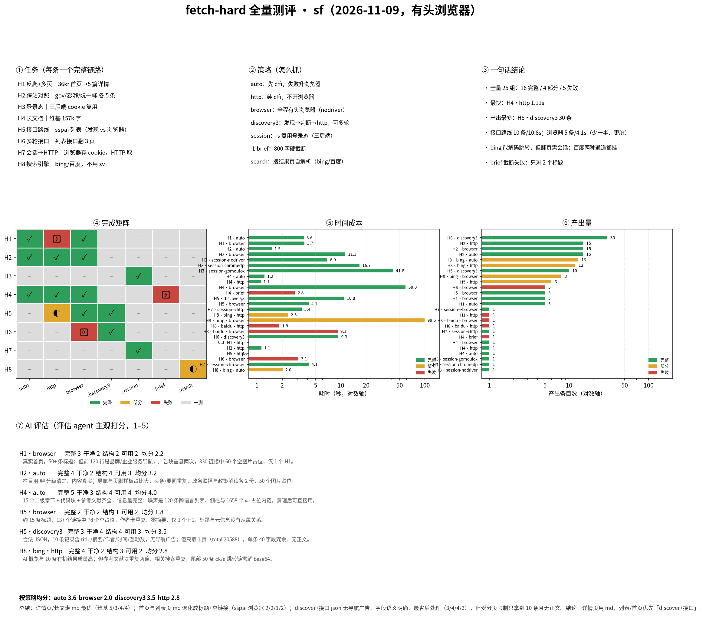

# fetch-hard 全量测评（2026-11-09）

| 项 | 值 |
|---|---|
| 被测 | sf（Go 版），**浏览器一律有头** |
| 任务 | H1–H8（搜索引擎 H8 也按 auto/http/browser/discovery3 全跑） |
| 组合 | 32 组 |
| 结果 | 16 完整 / 5 部分 / 11 失败 |

## 图表怎么读

颜色在所有子图里一致：

| 颜色/符号 | 含义 |
|---|---|
| 🟩 绿 / ✓ | 完整完成 |
| 🟨 黄 / ◐ | 部分完成 |
| 🟥 红 / ✗ | 失败（风控 / 解析不出 / 0 条） |
| ⬜ 灰 / – | **未测**（该任务没跑这个策略） |

**策略只有五种**：`auto`（先 cffi 再升浏览器）、`http`（纯 cffi）、`browser`（全程有头浏览器）、
`discovery3`（发现→判断→http，可多轮）、`session`（`-s` 登录态）。
`brief` 不是策略，是 `-L brief` 截断档位，只在 H4 测。

## 结果明细

| 任务 | 策略 | 完成 | 产出 | 耗时 |
|---|---|---|---|---|
| H1 | auto | ✅ | 5 | 3.61s |
| H1 | browser | ✅ | 5 | 3.67s |
| H1 | discovery3 | ❌ | 0 | 5.47s |
| H1 | http | ❌ | 0 | 0.32s |
| H2 | auto | ✅ | 15 | 1.5s |
| H2 | browser | ✅ | 15 | 11.26s |
| H2 | discovery3 | ❌ | 0 | 6.88s |
| H2 | http | ✅ | 15 | 1.13s |
| H3 | session-chromedp | ✅ | 1 | 16.69s |
| H3 | session-gomoufox | ✅ | 1 | 41.84s |
| H3 | session-nodriver | ✅ | 1 | 6.86s |
| H4 | auto | ✅ | 1 | 1.23s |
| H4 | brief | ❌ | 1 | 2.83s |
| H4 | browser | ✅ | 1 | 58.97s |
| H4 | http | ✅ | 1 | 1.11s |
| H5 | auto | ◐ | 6 | 0.83s |
| H5 | browser | ✅ | 5 | 4.12s |
| H5 | discovery3 | ✅ | 10 | 10.84s |
| H5 | http | ◐ | 6 | 0.61s |
| H6 | browser | ❌ | 5 | 3.11s |
| H6 | discovery3 | ✅ | 30 | 9.34s |
| H6 | http | ❌ | 6 | 0.77s |
| H7 | session→browser | ✅ | 1 | 4.14s |
| H7 | session→http | ✅ | 1 | 3.4s |
| H8 | baidu·auto | ❌ | 1 | 1.93s |
| H8 | baidu·browser | ❌ | 1 | 9.13s |
| H8 | baidu·discovery3 | ❌ | 0 | 9.64s |
| H8 | baidu·http | ❌ | 1 | 1.85s |
| H8 | bing·auto | ◐ | 13 | 2.02s |
| H8 | bing·browser | ◐ | 8 | 99.45s |
| H8 | bing·discovery3 | ❌ | 0 | 8.44s |
| H8 | bing·http | ◐ | 12 | 2.34s |

## 分任务结论

### H1 反爬（36kr）

auto / browser / discovery3 三条：auto 与 browser 都 5 篇详情 5/5；**http 0 条**（纯 cffi 完全拿不到）；
**discovery3 0 条**——36kr 的 XHR 都是埋点/推荐位，没有可直取的列表接口。

### H2 跨站（gov / 澎湃 / 阮一峰）

auto / http / browser 都 15 条；auto 1.5s、http 1.1s、browser 11.3s。
**discovery3 0 条**：三个站都是服务端渲染，没有 JSON 列表接口可捡。

### H3 会话

session × 三后端全部成功：nodriver 6.9s、chromedp 16.7s、gomoufox 41.8s。

### H4 长文档

auto / http / browser 结果完全一致（157k 字、33 标题）；耗时 1.2s / 1.1s / 59.0s。
`-L brief` 失败：787 字、2 个标题——截断毁结构。

### H5 接口路线（sspai 列表）

discovery3 **10 条 / 10.8s**（发现 9s + 取数 0.5s）；browser 5 条 / 4.1s；http 6 条 / 0.6s；auto 6 条。
接口路线条目最多、最干净，代价是一次性发现。

### H6 多轮接口

discovery3 **30 条 / 9.3s**（3 页，每页 0.5s）；browser 5 条；http 6 条——不发现接口就翻不出多页。

### H7 会话跨通道

session→http 3.4s、session→browser 4.1s，都能读到 cookie。

### H8 搜索引擎（不用 sv）

| 策略 | bing | 百度 |
|---|---|---|
| auto | ◐ 13 条 / 2.0s | ❌ 1 条 |
| http | ◐ 12 条 / 2.3s | ❌ 1 条 |
| browser | ◐ 8 条 / 99.5s | ❌ 1 条 |
| discovery3 | ❌ 0 条 / 8.4s | ❌ 0 条 / 9.6s |

- bing：跳转链能解 base64，两种策略都能拿到 12–13 条，但**cffi 翻页无效**（两页重叠 9 条），
  浏览器能翻页却要 99.5s 且首屏被 AI 摘要挤占；
- **discovery3 对搜索引擎无效**：结果页是服务端渲染，XHR 里没有结果数据，找不到可直取的接口；
- 百度三种策略都只有 1 条（DOM 结构完全不同，不是风控）。

## AI 评估（评估 agent，1–5 分）

评估对象是「任务 × 策略」的产出样本：

| 任务·策略 | 完整 | 干净 | 结构 | 可用 | 均分 |
|---|---|---|---|---|---|
| H4·auto（维基长文） | 5 | 3 | 4 | 4 | **4.0** |
| H5·discovery3（接口 JSON） | 3 | 4 | 4 | 3 | 3.5 |
| H2·auto（gov 首页） | 4 | 2 | 4 | 3 | 3.25 |
| H8·bing·http（搜索结果页） | 4 | 2 | 3 | 2 | 2.75 |
| H1·browser（36kr 首页） | 3 | 2 | 2 | 2 | 2.25 |
| H5·browser（sspai 首页） | 2 | 2 | 1 | 2 | 1.75 |

**按策略均分**：`auto 3.6` · `discovery3 3.5` · `http(搜索) 2.8` · `browser 2.0`

评估员结论：**详情页用 md，列表/首页优先 discover+接口**；
浏览器抓首页/列表最脏（空链接、图片占位、卡片重复）。

## 局限

- 每组合跑 1 次；36kr 状态今天时好时坏。
- H5/H6 条目按 JSON `data` 长度计，跨页未去重。
- H8 只算外链，未剔除「必应如何提供搜索结果」这类摘要来源。
