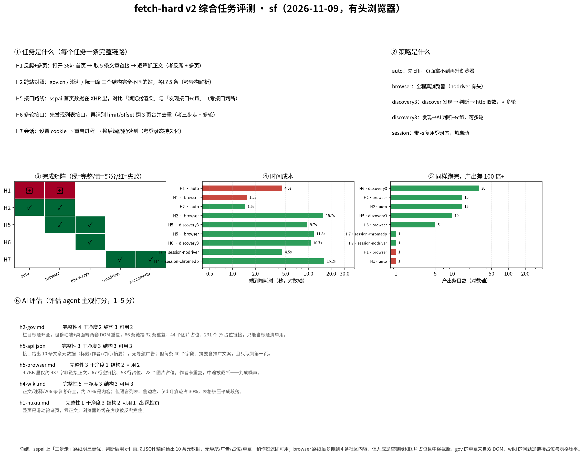
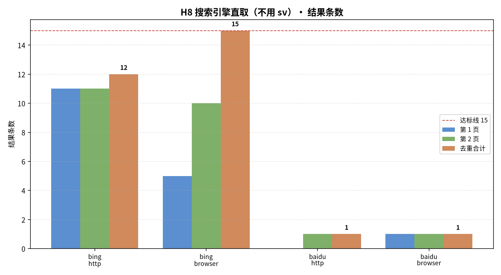

# fetch-hard v2 实测结果（2026-11-09，有头浏览器）

按 `FETCH-HARD-TASK.md` 执行。只测 sf。
**浏览器一律有头**（主人要求：宁可显示窗口也不用无头）。

---

## 1. 三条策略线

| 策略 | 含义 | 本次覆盖 |
|---|---|---|
| **auto** | 先 cffi，拿不到再升浏览器 | H1/H2 |
| **browser** | 全程真浏览器（nodriver，有头） | H1/H2/H5/H7 |
| **discovery3**（三步走，**流程不是参数**） | `--discover` 发现 → agent 判断 → `--via http` 取数，可多轮 | H5/H6 |
| **session** | `-s` 复用登录态 | H7 × nodriver/chromedp |

---

## 2. 结果

| 任务 | 策略 | 完成 | 产出 | 端到端 | 备注 |
|---|---|---|---|---|---|
| H1 36kr 反爬+多页 | auto | ❌ | 0 | 4.5s | 返回 `Untitled Page`（风控） |
| H1 | browser | ❌ | 0 | 1.5s | 同上 |
| H1 | api | ❌ | 0 | 6.2s | 同上，发现不到接口 |
| H2 跨站对照 | auto | ✅ | 15 条 | **1.5s** | |
| H2 | browser | ✅ | 15 条 | 15.7s | 慢 10 倍，结果一样 |
| H5 sspai 列表 | **discovery3** | ✅ | **10 条** | 9.7s（发现 9.2 + 取数 0.5） | JSON，干净 |
| H5 | browser | ✅ | 5 条 | 11.8s | 九成噪声 |
| H6 多轮接口 | **discovery3** | ✅ | **30 条** | 10.7s | 4 轮：发现→判断→http→翻页 |
| H7 会话 | session·nodriver | ✅ | 恢复成功 | 4.5s | |
| H7 | session·chromedp | ✅ | 恢复成功 | 16.2s | |

---

## 3. AI 评估（评估 agent 主观打分，1–5）

| 样本 | 完整性 | 干净度 | 结构 | 可用 | 风控页 |
|---|---|---|---|---|---|
| h2-gov.md | 4 | 2 | 3 | 2 | 否 |
| **h5-api.json** | 3 | **3** | 3 | **3** | 否 |
| h5-browser.md | 3 | **1** | 2 | 2 | 否 |
| h4-wiki.md | **5** | 3 | 3 | 3 | 否 |
| h1-huxiu.md | 1 | 3 | 2 | 1 | **是** |

评估结论（原文摘录）：

> sspai 上 api 路线明显更优：cffi 直取 JSON 精确给出 10 条元数据，没有导航/广告/图占位和重复块，
> 稍作过滤即可直接用；browser 路线虽多抓到 4 条社区内容，但 9.7KB 输出里九成是空链接、图片占位
> 和重复作者卡，还在列表中途截断。

> gov 首页约三分之一条目因移动/桌面双 DOM 重复，231 个 `@` 链接占位全不可解析；
> wiki 正文齐全（约 70% 是内容），但语言列表和 `[edit]` 痕迹占 30%，表格被压平成段落。

---

## 4. 结论

1. **三步走（discover→判断→http）是接口型站点的最优解**：sspai 用 9.7s 拿到 10 条干净数据，
   浏览器 11.8s 只拿到 5 条且九成噪声；H6 发现一次后分页每页只要 0.5s，30 条共 10.7s。
2. **浏览器只在「必须渲染或过指纹」时值得**：H2 慢 10 倍、H5 慢 20 倍且更脏。
3. **反爬目前是硬墙**：36kr / 虎嗅 / 界面在本机全部返回验证页（滑动验证），三种策略都拿不到；
   这不是 sf 的问题，是出口 IP 信誉。
4. **AI 评估能发现量化指标看不到的问题**：@ 链接占位、双 DOM 重复、表格压平，
   这些在 `img_ratio`/`nav_line_ratio` 里都不显眼。

---

## 5. 局限

- H1 因站点风控未能测出，反爬维度的数据来自 H3/H5 历史结果与本次风控观察。
- 每组合跑 1 次；站点内容随时变动，条目数会浮动。
- 三步走的「第 2 步判断」由 agent 完成；本次实测是我人工判断后执行，
  没有做成自动参数（`--via api` 已移除）。
- AI 评估基于 5 份样本，样本代表性有限。

---

## 6. H8 搜索引擎直取（不使用 sv）

按 `FETCH-HARD-TASK.md` H8 执行：`sf` 直接抓搜索结果页，自己解析标题、解码 `ck/a` 跳转、翻页去重。

| 引擎 | 通道 | 第 1 页 | 第 2 页 | 去重合计 | 每页耗时 | 判定 |
|---|---|---|---|---|---|---|
| bing | http | 11 | 11 | **12** | 1.83s / 1.45s | partial |
| bing | browser | 5 | 10 | **15** | 2.98s / 13.42s | full |
| baidu | http | 0 | 1 | **1** | 1.01s / 1.79s | fail |
| baidu | browser | 1 | 1 | **1** | 4.31s / 3.5s | fail |

### 结论

1. **bing 的 `ck/a` 跳转链可以解码**：`u=a1<base64url>` 解出来的全是真实域名
   （rust-lang.github.io、tokio.rs、geek-doc.cn 等），没有残留 `bing.com/ck/a`。
2. **但 cffi 翻页无效**：`first=11` 甚至 `first=11&FORM=PERE` 抓回来的还是第 1 页，
   两页去重后只多了 2 条（p1=12、p2=11、重叠 9）。bing 靠会话/Referer 判断翻页，
   纯 HTTP 拿不到第 2 页。
3. **浏览器通道能翻页**：第 2 页真实拿到 10 条新结果，合计 15 条达标；但第 1 页只有 5 条、
   第 2 页花 13.4s——首屏被 AI 摘要块占了，速度也慢一个数量级。
4. **百度两条通道都失败**：cffi 0 条、浏览器 1 条。结果块 DOM 和 bing 完全不同
   （`mu`/`result` 结构），现有正则解析不出来，不是风控问题。
5. **标题有噪音**：bingo 摘要把「必应如何提供搜索结果」也当成结果链接，需要按域名/块类型过滤。

### 对策略的启示

- 搜索引擎这种「分页强依赖会话」的站，**cffi 单打独斗不够**，需要带 cookie 的会话
  （`-s` + 先访问首页）或直接走浏览器；
- 这正是 `sv` 存在的理由——它内置了每个引擎的分页参数、Referer 链和广告过滤；
  不用 `sv` 时，这些都得自己补。
